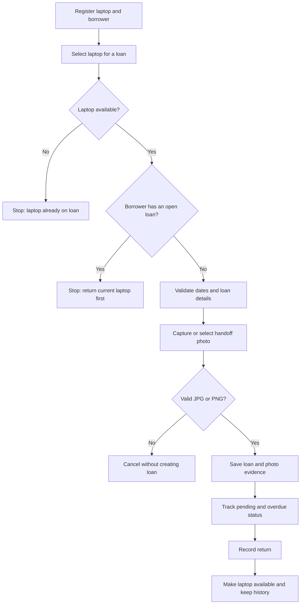

# 🔄 PortaLoop

<div align="center">

### Keep every laptop in the loop.

A laptop lending tracker for educational institutions, with borrower validation, due-date tracking, return records, and photo evidence.

[Features](#-features) · [Getting started](#-getting-started) · [How it works](#-how-it-works) · [Project challenge](#-project-challenge-responses) · [Roadmap](#-next-steps)


</div>

---

## 💻 What is PortaLoop?

PortaLoop helps a school or training center keep track of who has each laptop, when it is due back, and whether it has been returned. It records a photo of the laptop at handoff and prevents a borrower from checking out another device while one is still on loan.

The project is designed as a simple, local-first console app. It stores records in a JSON file and keeps handoff photos in a local evidence folder.

## ✨ Features

- 🧰 Register laptops with a unique asset code and description.
- 👤 Register borrowers with a unique ID, name, and optional contact.
- 🔐 Enforce one active laptop loan per borrower and one active borrower per laptop.
- 📸 Require a JPG or PNG handoff photo before completing a loan.
- 📅 Validate dates and flag overdue loans.
- 🔁 Record returns, release the laptop, and retain the loan history.
- 📋 View pending loans, available laptops, and recent history.
- 💾 Save records locally between sessions, with no external packages or internet connection required.

## 🧱 Tech stack

| Technology | Role |
|---|---|
| PowerShell 5.1+ | Console interface and application logic |
| JSON | Local borrower, laptop, and loan records |
| Windows Camera | Optional handoff-photo capture |
| JPG / PNG | Supported photo evidence formats |

## 🚀 Getting started

### Requirements

- Windows with Windows PowerShell 5.1 or PowerShell 7.
- No package installation or internet access is needed to run the app.

### Run PortaLoop

1. Download or clone this repository.
2. Open PowerShell in the project folder.
3. Run:

   ```powershell
   .\main.ps1
   ```

4. Register a laptop and a borrower before creating a loan.
5. Choose **0** to exit. PortaLoop saves confirmed changes automatically.

### Menu

| Option | Action |
|---:|---|
| 1 | Register a laptop |
| 2 | Register a borrower |
| 3 | Create a loan and attach handoff photo |
| 4 | View pending and overdue loans |
| 5 | Record a return |
| 6 | View available laptops |
| 7 | View loan history |
| 0 | Save and exit |

When creating a loan, PortaLoop opens the Windows Camera app and asks for the saved JPG or PNG photo. The app copies the image into `evidencias/` and stores its relative path with the loan. If Camera does not open, take the photo with another camera app and enter its file path. Press Enter at the photo prompt to cancel the loan.

## 🔄 How it works



## 🗂️ Local data and privacy

On first use, PortaLoop creates `prestamos.json` and `evidencias/` beside the script. Back up both to preserve records. They are excluded from Git by `.gitignore` so borrower details and photos are not accidentally committed.

This MVP does not include accounts, role-based access, encryption, cloud sync, or multi-computer sharing. Confirm the center’s photo-consent, access, and retention rules before using real borrower information.

## 🎓 Project challenge responses

The following section answers the six questions in the assignment brief.

### 1. Describe the problem

El registro manual dificulta saber con certeza quién tiene cada portátil, cuándo debe devolverlo y qué préstamos siguen pendientes. Esto puede provocar retrasos, pérdida de equipos o asignaciones duplicadas. PortaLoop centraliza los datos y permite consultar el estado de cada préstamo.

### 2. What data should be recorded?

**Imprescindible:** código único y descripción del portátil; documento y nombre de la persona; fecha de entrega; fecha límite; fecha de devolución y evidencia fotográfica de la entrega.

**Por confirmar:** contacto obligatorio, accesorios que se controlarán por separado, condición física, autorización, plazo máximo, prórrogas, sanciones, manejo de daños, roles de usuario, tiempo de retención y copias de seguridad. En este MVP el contacto es opcional y los accesorios se anotan como texto.

### 3. Questions for the person responsible

- ¿Cómo se identifica cada portátil y qué características del equipo se deben guardar?
- ¿Qué personas pueden solicitarlo y qué documento se acepta?
- ¿Qué datos de contacto y autorizaciones son obligatorios?
- ¿La foto debe mostrar el estado del portátil, a la persona prestataria o ambos?
- ¿Cuál es el plazo máximo y se permiten prórrogas?
- ¿Cómo se registran daños, accesorios faltantes y devoluciones tardías?
- ¿Quién puede registrar, consultar o corregir préstamos?
- ¿Durante cuánto tiempo se conservan los datos y las fotos?
- ¿La aplicación debe compartir datos entre varios equipos o usuarios?

### 4. Sequence / pseudocode

```text
START
  Register laptops and borrowers
  Repeat until the user chooses Exit:
    Show menu
    If user chooses Lend:
      Confirm laptop exists and is available
      Confirm borrower exists and has no open loan
      Validate loan date and due date
      Capture/select handoff photo
      If photo is a supported image:
        Save photo and create the loan
      Otherwise:
        Cancel without creating the loan
    If user chooses Return:
      Select an open loan and validate return date
      Record return and release laptop
    If user chooses Consult:
      Show pending, overdue, available, or historical records
  Save confirmed changes
END
```

### 5. Tests and expected results

1. **Valid loan:** register a laptop and borrower, then create a loan with a future due date and JPG/PNG photo. Expected: loan appears as pending and the photo is copied to `evidencias/`.
2. **Borrower already has a laptop:** try to lend a second laptop before the first is returned. Expected: the new loan is blocked.
3. **Return then borrow again:** record the first laptop’s return and try again. Expected: the laptop becomes available and the borrower can receive another loan.
4. **Invalid input or missing photo:** use an invalid date, omit the photo, or select an unsupported file. Expected: validation message and no new loan.

### 6. Assumption and unresolved situation

**Supuesto:** cada portátil tiene un código único y cada persona puede tener como máximo un préstamo abierto. **Situación no resuelta:** el sistema no controla accesorios como inventario separado ni define cómo gestionar daños, prórrogas o sanciones; esas reglas deben confirmarse con el centro.

## 🛣️ Next steps

- Add configurable loan-duration rules and renewals.
- Track accessories as separate items.
- Add operator accounts and an audit log.
- Define photo-consent and retention workflows.
- Add reports for overdue loans and equipment usage.

---

<div align="center">

Made for keeping shared laptops moving—and accounted for. 💻🔄

</div>
