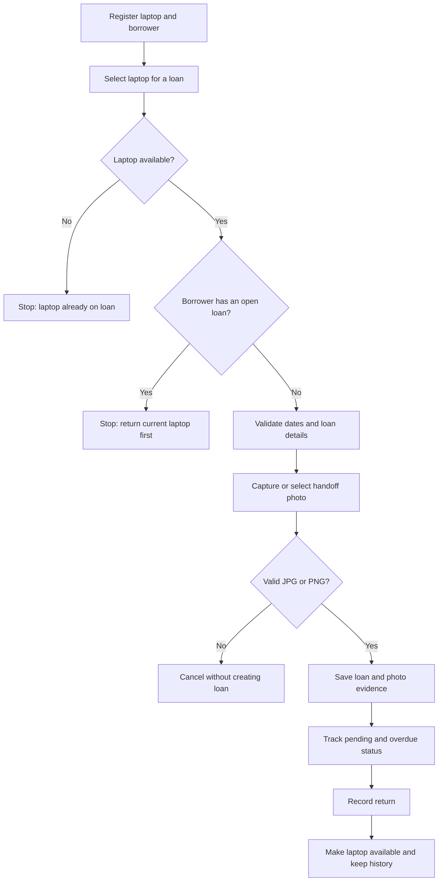

# 🔄 PortaLoop

<div align="center">

### Keep every laptop in the loop.

A laptop lending tracker for educational institutions, with borrower validation, due-date tracking, return records, and photo evidence.

[Features](#-features) · [Getting started](#-getting-started) · [How it works](#-how-it-works) · [Project challenge](#-project-challenge-responses) · [Roadmap](#-next-steps)


</div>

---

## 💻 What is PortaLoop?

PortaLoop helps a school or training center keep track of who has each laptop, when it is due back, and whether it has been returned. It records a photo of the laptop at handoff and prevents a borrower from checking out another device while one is still on loan.

The project is a local-first console app written in Python. It stores records in a JSON file and keeps handoff photos in a local evidence folder.

## ✨ Features

- 🧰 Register laptops with a unique asset code and description.
- 👤 Register borrowers with a unique ID, name, and optional contact.
- 🔐 Enforce one active laptop loan per borrower and one active borrower per laptop.
- 📸 Require a JPG or PNG handoff photo before completing a loan.
- 📅 Validate dates and flag overdue loans.
- 🔁 Record returns, release the laptop, and retain the loan history.
- 📋 View pending loans, available laptops, and recent history.
- 🎨 See live inventory and loan counts in a colorful console dashboard with a one-line KPI scoreboard, emoji labels, and a clearly separated main menu.
- 💾 Save records locally between sessions, with no third-party packages or internet connection required.

## 🧱 Tech stack

| Technology | Role |
|---|---|
| Python 3.10+ | Console interface and application logic |
| Python standard library | Input validation, file handling, dates, and photo copying |
| JSON | Local borrower, laptop, and loan records |
| Windows Camera | Optional handoff-photo capture on Windows |
| JPG / PNG | Supported photo evidence formats |

## 🚀 Getting started

### Requirements

- Python 3.10 or newer.
- Windows is recommended for the built-in Camera app. The rest of the console features use Python's standard library.
- No package installation or internet access is needed to run the app.

### Run PortaLoop

1. Download or clone this repository.
2. Open a terminal in the project folder.
3. Run one of these commands:

   ```bash
   python main.py
   ```

   On Windows, if `python` is not recognized, try:

   ```powershell
   py main.py
   ```

4. Register a laptop and a borrower before creating a loan.
5. Choose **0** to exit. PortaLoop saves confirmed changes automatically.

### Menu

| Option | Action |
|---:|---|
| 1 | Register a laptop |
| 2 | Register a borrower |
| 3 | Create a loan and attach handoff photo |
| 4 | View pending and overdue loans |
| 5 | Record a return |
| 6 | View available laptops |
| 7 | View loan history |
| 0 | Save and exit |

When creating a loan on Windows, PortaLoop opens the Camera app and asks for the saved JPG or PNG photo. The app copies the image into `evidencias/` and stores its relative path with the loan. If Camera does not open, take the photo with another camera app and enter its file path. Press Enter at the photo prompt to cancel the loan.

## 🔄 How it works



## 🗂️ Local data and privacy

On first use, PortaLoop creates `prestamos.json` and `evidencias/` beside the script. Back up both to preserve records. They are excluded from Git by `.gitignore` so borrower details and photos are not accidentally committed.

This MVP does not include accounts, role-based access, encryption, cloud sync, or multi-computer sharing. Confirm the center’s photo-consent, access, and retention rules before using real borrower information.

## 🎓 Project challenge responses

The following section answers the six questions in the assignment brief.

### 1. Describe the problem

The manual process makes it difficult to know who has each laptop, when it is due, and which loans are still open. This can lead to late returns, lost equipment, or duplicate assignments. PortaLoop centralizes these records and makes each loan’s status easy to check.

### 2. What data should be recorded?

**Essential:** a unique laptop asset code and description; the borrower's ID and name; the checkout date; the due date; the return date; and a photo of the laptop at handoff.

**To confirm with the center:** whether contact details are mandatory; which accessories need separate tracking; how device condition and loan authorization are recorded; maximum loan duration and renewal rules; late-return penalties; damage procedures; user roles; data and photo retention; and backup procedures. In this MVP, contact details are optional and accessories can be listed in free-text notes.

### 3. Questions for the person responsible

- How is each laptop identified, and which device details must be recorded?
- Who is eligible to borrow equipment, and which forms of ID are accepted?
- Which contact details and approvals are required?
- Should the handoff photo show the laptop's condition, the borrower, or both?
- What is the maximum loan period, and are renewals allowed?
- How should damage, missing accessories, and late returns be handled?
- Who may create, view, or correct loan records?
- How long should records and photos be retained?
- Does the application need to share data across multiple computers or users?

### 4. Sequence / pseudocode

```text
START
  Register laptops and borrowers
  Repeat until the user chooses Exit:
    Display the menu
    If the user chooses Lend:
      Confirm the laptop exists and is available
      Confirm the borrower exists and has no open loan
      Validate the checkout date and due date
      Capture or select a handoff photo
      If the photo is a supported image:
        Save the photo and create the loan
      Otherwise:
        Cancel without creating the loan
    If the user chooses Return:
      Select an open loan and validate the return date
      Record the return and release the laptop
    If the user chooses Consult:
      Display pending, overdue, available, or historical records
  Save confirmed changes
END
```

### 5. Tests and expected results

1. **Valid loan:** register a laptop and borrower, then create a loan with a future due date and a JPG or PNG photo. Expected: the loan appears in the pending list and the photo is copied to `evidencias/`.
2. **Borrower already has a laptop:** try to lend a second laptop before the first one is returned. Expected: PortaLoop blocks the new loan.
3. **Return, then borrow again:** record the first laptop's return and try again. Expected: the laptop becomes available and the borrower can receive another loan.
4. **Invalid input or missing photo:** enter an invalid date, omit the photo, or select an unsupported file. Expected: PortaLoop displays a validation message and creates no loan.

### 6. Assumption and unresolved situation

**Assumption:** each laptop has a unique asset code, and each borrower may have at most one open loan. **Unresolved situation:** the system does not track accessories as separate inventory or define procedures for damage, renewals, and penalties. The center must confirm those rules before they are added.

## 🛣️ Next steps

- Add configurable loan-duration rules and renewals.
- Track accessories as separate items.
- Add operator accounts and an audit log.
- Define photo-consent and retention workflows.
- Add reports for overdue loans and equipment usage.

---

<div align="center">

Made for keeping shared laptops moving—and accounted for. 💻🔄

</div>

